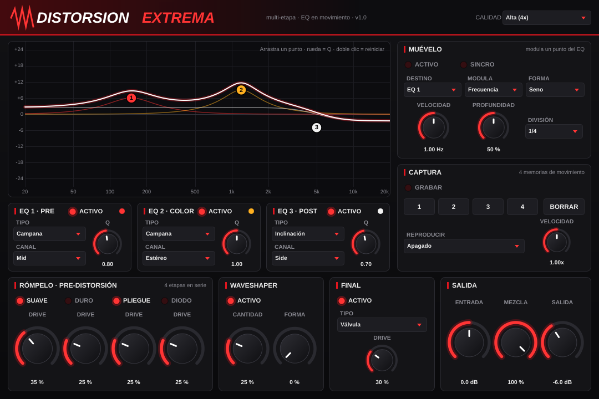

# DISTORSION EXTREMA

Plugin de distorsión multi-etapa con ecualizadores en movimiento.
Formatos: **VST3 y AU (Mac)**, **VST3 (Windows)** y **aplicación independiente** en los dos sistemas.



## Qué hace

Cadena de señal:

```
Entrada → EQ 1 (Pre, Mid/Side) → EQ 2 (Color) → 4 pre-distorsiones → Waveshaper
        → Distorsión final → EQ 3 (Post, Mid/Side) → efectos ocultos → Mezcla → Salida
```

| Sección | Controles |
|---|---|
| **3 ecualizadores** | Punto arrastrable en la gráfica (frecuencia/ganancia), Q con la rueda. 8 tipos: Campana, Muesca, Pasa-bajos, Pasa-altos, Banda, Inclinación, Formante (doble pico) y Peine. Canal: Estéreo, Mid o Side. Filtros SVF que se pueden mover muy rápido sin clicks. En pasa-bajos/altos y muesca, subir el punto aumenta la resonancia; en Peine controla la realimentación. |
| **MUÉVELO** | LFO que modula la frecuencia, la ganancia o ambas de cualquier EQ. 5 formas (seno, triángulo, sierra, cuadrada, aleatoria), libre en Hz o sincronizado al tempo (4 compases … 1/16). |
| **CAPTURA** | Con GRABAR activo, al arrastrar un punto se graba el movimiento (hasta 60 s). 4 memorias, se reproducen en bucle con velocidad 0.25x–4x y se guardan con el proyecto. |
| **RÓMPELO** | 4 pre-distorsiones en serie: Suave (tanh), Duro (clip), Pliegue (wavefolder), Diodo (asimétrico). |
| **WAVESHAPER** | Cantidad + Forma (de saturación agresiva a plegado senoidal). |
| **FINAL** | Válvula, Fuzz o Rectificador (sube una octava). |
| **SALIDA** | Entrada, Mezcla (dry/wet con compensación de latencia), Salida. Calidad de sobremuestreo 2x / 4x / 8x. |
| **SECRETO** | Clic en el logo: Destrozo (bitcrush + downsample), Anillo (modulador en anillo) y su frecuencia. |

## Cómo obtener los plugins compilados (sin instalar nada)

1. Crea una cuenta gratuita en [github.com](https://github.com).
2. Crea un repositorio nuevo (botón **New**), por ejemplo `distorsion-extrema`.
3. Sube todo el contenido de esta carpeta: en el repositorio, **Add file → Upload files**,
   arrastra todos los archivos y carpetas (incluida la carpeta oculta `.github`) y pulsa **Commit changes**.
   > En Mac, para ver `.github` en Finder pulsa `Cmd + Mayús + .`
4. Ve a la pestaña **Actions**. Verás "Compilar DISTORSION EXTREMA" en marcha (unos 10–15 min).
5. Cuando termine (marca verde), entra en la ejecución y abajo, en **Artifacts**, descarga:
   - `DISTORSION-EXTREMA-macOS` → contiene `DISTORSION-EXTREMA-macOS.zip` (VST3 + AU + .app)
   - `DISTORSION-EXTREMA-Windows` → contiene `DISTORSION-EXTREMA-Windows.zip` (VST3 + .exe)
6. Sigue `INSTALAR.txt`.

Si creas una etiqueta `v1.0.0` (pestaña Releases → Draft a new release), los zips se publican además en Releases.

## Compilar en tu ordenador (opcional)

Necesitas CMake ≥ 3.22 y Xcode (Mac) o Visual Studio 2022 (Windows):

```bash
cmake -B build -DCMAKE_BUILD_TYPE=Release
cmake --build build --config Release --target DistorsionExtrema_All
```

Los resultados quedan en `build/DistorsionExtrema_artefacts/Release/`.

## Notas

- Los plugins de Mac llevan firma ad-hoc, no firma de Apple: hay que quitar la cuarentena la primera vez (ver `INSTALAR.txt`). Para distribuirlo al público conviene firmarlo y notarizarlo con una cuenta de Apple Developer.
- Está hecho con [JUCE 8](https://juce.com). Si vas a venderlo, revisa las condiciones de licencia de JUCE en su web.
- Banco de pruebas offline: `cmake -B build -DDEX_BUILD_TESTS=ON && cmake --build build --target DexTests`.
